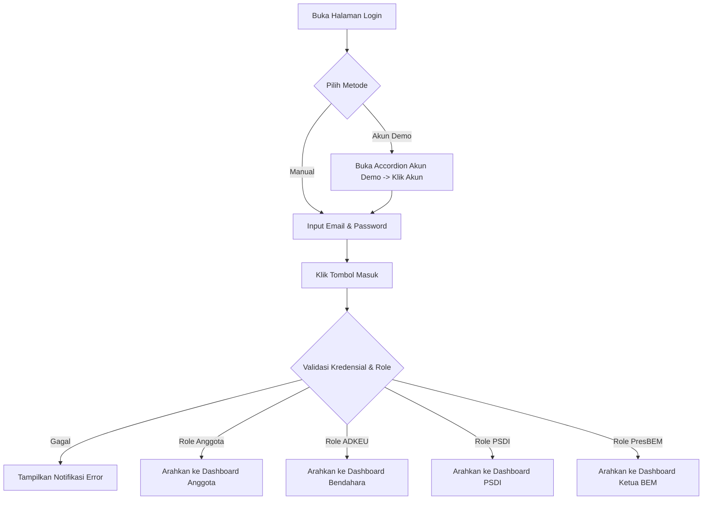

# Modul 01: Autentikasi, Akun Demo & Manajemen Profil

## 1. Deskripsi Fitur
Modul Autentikasi dan Manajemen Profil merupakan gerbang utama sistem **Rekapin**. Modul ini menjamin keamanan akses berbasis peran (*Role-Based Access Control / RBAC*), menyediakan pembuatan akun oleh admin, serta memberikan pengalaman *onboarding* saat evaluasi prototipe melalui fitur **Akun Demo Cepat**.

---

## 2. Acuan Tangkapan Layar (Screenshots)
- **Login Layar Penuh & Role Selector**:
  - [`Rekapin-Resource/UI-Bendahara/login bendahara.png`](file:///c:/Users/Archie/Downloads/MPTI-Kelompok1/Rekapin-Resource/UI-Bendahara/login%20bendahara.png)
  - [`Rekapin-Resource/UI-Anggota/login anggota.png`](file:///c:/Users/Archie/Downloads/MPTI-Kelompok1/Rekapin-Resource/UI-Anggota/login%20anggota.png)
  - [`Rekapin-Resource/UI-PSDI/login psdi.png`](file:///c:/Users/Archie/Downloads/MPTI-Kelompok1/Rekapin-Resource/UI-PSDI/login%20psdi.png)
  - [`Rekapin-Resource/UI-PresBem/login pres.png`](file:///c:/Users/Archie/Downloads/MPTI-Kelompok1/Rekapin-Resource/UI-PresBem/login%20pres.png)
- **Komponen Akun Demo Cepat**:
  - [`Rekapin-Resource/UI-Bendahara/Login (Buat Berdasarkan Rancangan).png`](file:///c:/Users/Archie/Downloads/MPTI-Kelompok1/Rekapin-Resource/UI-Bendahara/Login%20(Buat%20Berdasarkan%20Rancangan).png)
- **Halaman Profil Pengguna**:
  - [`Rekapin-Resource/UI-Anggota/profil anggota.png`](file:///c:/Users/Archie/Downloads/MPTI-Kelompok1/Rekapin-Resource/UI-Anggota/profil%20anggota.png)
  - [`Rekapin-Resource/UI-Bendahara/profil adkeu.png`](file:///c:/Users/Archie/Downloads/MPTI-Kelompok1/Rekapin-Resource/UI-Bendahara/profil%20adkeu.png)
  - [`Rekapin-Resource/UI-PSDI/profil psdi.png`](file:///c:/Users/Archie/Downloads/MPTI-Kelompok1/Rekapin-Resource/UI-PSDI/profil%20psdi.png)
  - [`Rekapin-Resource/UI-PresBem/profil pres.png`](file:///c:/Users/Archie/Downloads/MPTI-Kelompok1/Rekapin-Resource/UI-PresBem/profil%20pres.png)

---

## 3. Komponen & Spesifikasi Antarmuka (UI Specification)

### 3.1. Halaman Masuk (Login Screen)
Desain mengusung konsep *Split-Screen* (dua kolom):
1. **Kolom Kiri (Branding & Identitas Organisasi)**:
   - **Logo & Nama Organisasi**: Ikon gedung BEM FILKOM UB berlatar hijau toska gelap.
   - **Badge Kategori**: Pill dengan tulisan *"Sistem Manajemen Organisasi"* atau *"Sistem Manajemen Internal"*.
   - **Headline Inspiratif**: *"Kelola kas & kehadiran dengan lebih efisien."*
   - **Deskripsi Singkat**: *"Platform terpusat untuk manajemen kas, iuran, denda, piket, dan presensi kegiatan BEM FILKOM Universitas Brawijaya."*
   - **Petunjuk Role Tersedia**: Peran aplikasi (`ADKEU`, `PresBEM`, `PSDI`, `Anggota Biasa`) dan `Admin`.
2. **Kolom Kanan (Formulir Masuk & Demo)**:
   - **Judul**: *"Masuk ke akun Anda"*
   - **Sub-judul**: *"Sistem Kas & Presensi BEM FILKOM UB"*
   - **Input Email**: Kotak teks dengan *placeholder* e.g. `ananda@bem-filkom.ub.ac.id` / `nayla@bem-filkom.ub.ac.id`.
   - **Input Password**: Kotak password dilengkapi tombol ikon mata (*show/hide password toggle*).
   - **Fitur Ingat Saya**: Kotak centang (*checkbox*) *"Ingat saya"*.
   - **Tautan Lupa Password**: Link interaktif menuju alur reset password.
   - **Tombol Masuk**: Tombol *Primary Teal* berukuran penuh.
   - **Widget Akun Demo (*Collapsible Accordion*)**:
     - Membuka daftar 4 kartu pengguna prasetel.
     - Setiap kartu menampilkan: Avatar inisial, Nama pengguna, Email, Password tersembunyi/terbuka, dan Label Role berwarna.
     - Interaksi: Satu klik pada kartu akan langsung mengisi field Email dan Password formulir secara instan (*auto-fill*).
   - **Footer Copyright**: *"© 2025 BEM FILKOM Universitas Brawijaya"*.

### 3.2. Data Kredensial Akun Demo (Berdasarkan Rancangan)
| Role Badge | Nama Lengkap | Email Akun | Kata Sandi | Deskripsi Posisi |
| :--- | :--- | :--- | :--- | :--- |
| **ADKEU** | Rizky Pratama / Nayla Shaffa | `rizky@bem-filkom.ub.ac.id` / `nayla@bem-filkom.ub.ac.id` | `adkeu123` | Bendahara Umum BEM |
| **PresBEM** | Ahmad Fauzi / M. Daffa Riyadlussalam | `ahmad@bem-filkom.ub.ac.id` / `daffa@bem-filkom.ub.ac.id` | `presbem123` | Ketua BEM / Eksekutif |
| **PSDI** | Siti Aisyah / Vanessa Dewi Agustina | `siti@bem-filkom.ub.ac.id` / `vanessa@bem-filkom.ub.ac.id` | `psdi123` | Kepala Departemen PSDI |
| **Anggota Biasa** | Budi Santoso / Ananda | `budi@student.ub.ac.id` / `ananda@bem-filkom.ub.ac.id` | `anggota123` | Fungsionaris / Anggota BEM |

---

### 3.3. Halaman Profil Pengguna (Profile Screen)
Menyajikan informasi identitas pengguna serta status kewajiban individual:
1. **Banner Profil**:
   - Avatar inisial besar (lingkaran persegi melengkung berlatar gelap).
   - Nama lengkap dan Jabatan/Peran resmi (e.g. *"M. Daffa Riyadlussalam - Ketua BEM"*, *"Nayla Shaffa - Bendahara Umum"*, *"Vanessa Dewi Agustina - Kepala Departemen PSDI"*, *"Ananda - Anggota Biasa"*).
   - Grid informasi identitas:
     - **NIM**: Nomor Induk Mahasiswa 15 digit (contoh: `245150700111001`).
     - **Departemen**: Satuan kerja (e.g. `Umum`, `ADKEU`, `PSDI`, `Eksekutif`).
     - **Angkatan**: Tahun angkatan mahasiswa (e.g. `2023`, `2024`, `2025`).
     - **Email**: Alamat email resmi universitas/organisasi.
2. **Kartu Ringkasan Kewajiban Individual (Personal Accountability Card)**:
   - **Status Kas Bulan Ini**: Menampilkan status real-time dengan badge `Lunas` (hijau) atau `Belum Lunas` (merah).
   - **Denda Aktif**: Total nominal rupiah tagihan denda berjalan (contoh: `Rp0` atau `Rp25.000`).
   - **Kehadiran Piket**: Persentase kepatuhan piket sekretariat (contoh: `87%`).
   - **Total Kas Dibayar**: Akumulasi total kas yang telah berhasil disetorkan sepanjang periode kepengurusan (contoh: `Rp350.000`).
3. **Menu Pengaturan & Aksi Akun**:
   - ✏️ **Edit Profil**: Memperbarui informasi personal dasar dan kontak.
   - 🔐 **Ganti Password**: Memperbarui kata sandi akun dengan konfirmasi keamanan.
   - 🔔 **Notifikasi**: Preferensi pengingat pembayaran kas dan peringatan piket.
   - ℹ️ **Tentang Aplikasi**: Informasi versi sistem Rekapin dan tim pengembang MPTI Kelompok 1.
   - 🚪 **Tombol Keluar dari Akun (*Logout*)**: Tombol batas merah (*outline button*) dengan konfirmasi pemutusan sesi aman.

---

## 4. Alur Kerja (User Flows)

---

## 5. Aturan Bisnis & Validasi (Business Rules)
1. **Validasi Email**: Format email wajib menggunakan domain `@bem-filkom.ub.ac.id` atau `@student.ub.ac.id`.
2. **Kekuatan Password**: Minimal 8 karakter mencakup kombinasi huruf dan angka pada saat pendaftaran/ubah password.
3. **Session Timeout & Remember Me**: Pengguna otomatis dikeluarkan setelah 30 menit tanpa aktivitas, termasuk jika *"Ingat saya"* aktif. Nilai ini dapat diubah dengan `SESSION_IDLE_TIMEOUT`; `SESSION_LIFETIME` tetap mengatur umur sesi Laravel.
4. **Proteksi Hak Akses**: Pengguna tidak dapat melompat ke rute URL role lain tanpa memiliki wewenang yang sesuai (*Middleware RBAC*).
5. **Autentikasi Login**: Semua halaman login per role mengirim kredensial ke endpoint autentikasi yang sama. Sistem hanya menerima kata sandi yang cocok dengan akun tersebut, lalu mengarahkan pengguna ke dashboard berdasarkan role akun; pemilihan halaman login tidak memberikan hak akses.
6. **Pembatasan Percobaan Login**: Endpoint login membatasi lima percobaan per menit untuk mengurangi risiko tebakan kata sandi otomatis.
7. **Logout**: Semua layout role mengirim logout melalui `POST` dengan token CSRF; endpoint tidak menerima `GET`. Timeout idle memeriksa aktivitas pada setiap permintaan terautentikasi, menghapus sesi yang kedaluwarsa, lalu meminta pengguna masuk kembali.
8. **Admin**: Admin dibuat melalui perintah terminal `php artisan admin:create`, lalu login melalui halaman login yang sama. Admin hanya memiliki halaman untuk menambah akun; role yang dapat dibuat adalah anggota, ADKEU/Bendahara, PresBEM, dan PSDI. Admin tidak dapat membuat admin lain ataupun mengakses fitur operasional. Password akun baru minimal 8 karakter dan harus memuat huruf serta angka.

### 5.1. Membuat Akun Pengguna
Admin mengisi nama, email, role, password awal, dan konfirmasi password. NIM, departemen, angkatan, dan jabatan bersifat opsional. Email harus unik; password disimpan dalam bentuk hash. Buat akun admin pertama dari terminal tepercaya dengan `php artisan admin:create`; perintah meminta data secara interaktif dan tidak menggunakan kredensial default.
