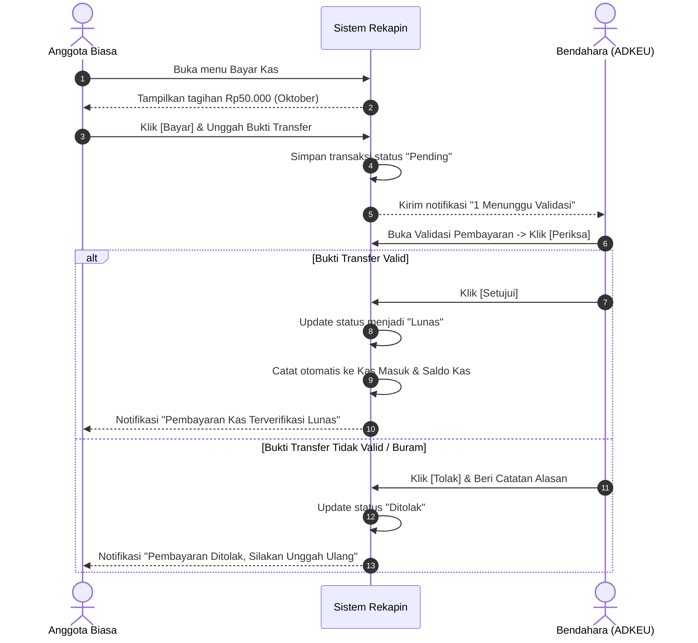

# Modul 03: Manajemen Kas & Keuangan Organisasi

## 1. Deskripsi Fitur
Modul Manajemen Kas dan Keuangan merupakan salah satu pilar utama dalam sistem **Rekapin**. Modul ini menyediakan sistem akuntansi kas berbasis organisasi yang transparan, akuntabel, dan efisien. Fitur ini mengelola pencatatan kas masuk dan keluar secara berkesinambungan, penagihan dan pembayaran kas rutin bulanan anggota, verifikasi/validasi bukti transfer oleh bendahara (ADKEU), matriks kepatuhan iuran per anggota, visualisasi komparasi pendapatan-belanja, serta ekspor laporan keuangan format PDF resmi.

---

## 2. Acuan Tangkapan Layar (Screenshots)
- **Halaman Kas Utama & Mutasi (ADKEU)**: [`Rekapin-Resource/UI-Bendahara/kas adkeu.png`](file:///c:/Users/Archie/Downloads/MPTI-Kelompok1/Rekapin-Resource/UI-Bendahara/kas%20adkeu.png)
- **Modal Tambah Transaksi Kas Masuk**: [`Rekapin-Resource/UI-Bendahara/kas masuk.png`](file:///c:/Users/Archie/Downloads/MPTI-Kelompok1/Rekapin-Resource/UI-Bendahara/kas%20masuk.png)
- **Modal Tambah Transaksi Kas Keluar**: [`Rekapin-Resource/UI-Bendahara/kas keluar.png`](file:///c:/Users/Archie/Downloads/MPTI-Kelompok1/Rekapin-Resource/UI-Bendahara/kas%20keluar.png)
- **Halaman Validasi Pembayaran (ADKEU)**: [`Rekapin-Resource/UI-Bendahara/validasi pembayaran.png`](file:///c:/Users/Archie/Downloads/MPTI-Kelompok1/Rekapin-Resource/UI-Bendahara/validasi%20pembayaran.png)
- **Halaman Rekap Kas & Matriks Iuran (ADKEU & PresBEM)**: 
  - [`Rekapin-Resource/UI-Bendahara/rekap kas.png`](file:///c:/Users/Archie/Downloads/MPTI-Kelompok1/Rekapin-Resource/UI-Bendahara/rekap%20kas.png)
  - [`Rekapin-Resource/UI-PresBem/rekap kas.png`](file:///c:/Users/Archie/Downloads/MPTI-Kelompok1/Rekapin-Resource/UI-PresBem/rekap%20kas.png)
- **Halaman Bayar Kas & Riwayat Pribadi (Anggota & PresBEM)**:
  - [`Rekapin-Resource/UI-Anggota/bayar kas.png`](file:///c:/Users/Archie/Downloads/MPTI-Kelompok1/Rekapin-Resource/UI-Anggota/bayar%20kas.png)
  - [`Rekapin-Resource/UI-PresBem/riwayat pembayaran.png`](file:///c:/Users/Archie/Downloads/MPTI-Kelompok1/Rekapin-Resource/UI-PresBem/riwayat%20pembayaran.png)

---

## 3. Komponen & Spesifikasi Antarmuka (UI Specification)

### 3.1. Halaman Kas Anggota (*Bayar Kas Saya*)
Digunakan oleh **Anggota Biasa** dan **PresBEM** untuk memenuhi kewajiban iuran bulanan:
1. **Banner Progres Pembayaran Kas Bulanan**:
   - Judul & Deskripsi: *"Bayar Kas - Pembayaran kas bulanan anggota"*.
   - Status Ringkasan: Menampilkan teks besar contoh *"7/8 Bulan Lunas"*.
   - Progress Bar: Bar horizontal terisi sesuai persentase kepatuhan (contoh: 88%).
   - Badge Lingkaran: Menampilkan persentase kelunasan (contoh: `88%`).
2. **Kartu Tagihan Belum Dibayar (*Pending Bill Card*)**:
   - Ikon lingkaran merah dengan lambang koin `$` / `Rp`.
   - Nama Tagihan: Periode bulan (e.g. *"Oktober 2025 - Kas Bulanan BEM FILKOM UB"*).
   - Nominal Tagihan: Teks merah tebal (e.g. `Rp50.000`).
   - Tombol Aksi: `[Bayar]` (Tombol primer hijau toska).
3. **Daftar Riwayat Pembayaran Kas**:
   - Status per bulan tahun berjalan ditampilkan sebagai `Lunas` hanya setelah ADKEU menyetujui bukti. Periode tanpa pengajuan atau pengajuan yang ditolak/menunggu verifikasi tetap `Belum lunas`.
   - Tabel riwayat menampilkan periode, tanggal pengajuan, jumlah, status pembayaran, tanggal verifikasi, pemeriksa, dan alasan penolakan bila ada. Riwayat hanya menampilkan data milik anggota yang sedang masuk.

---

### 3.2. Halaman Kas & Mutasi Pembukuan (ADKEU)
Digunakan oleh **ADKEU (Bendahara)** untuk tata kelola kas umum BEM:
1. **Ringkasan Saldo (3 Stat Cards)**:
   - **Saldo Saat Ini**: `Rp19.250.000` (Posisi saldo kas riil saat ini).
   - **Total Pemasukan**: `Rp22.350.000` (Akumulasi seluruh kas masuk periode aktif).
   - **Total Pengeluaran**: `Rp3.100.000` (Akumulasi biaya operasional & pengeluaran).
2. **Tombol Aksi**:
   - `[+ Tambah Transaksi]` di pojok kanan atas, memicu modal formulir transaksi.
3. **Filter Jenis Transaksi**:
   - Tombol pill: `Semua` | `Masuk` | `Keluar`.
4. **Tabel Riwayat Mutasi Kas**:
   - **TANGGAL**: Tanggal transaksi dicatat (format `DD/MM/YYYY`).
   - **KETERANGAN**: Uraian transaksi (e.g. *Saldo Awal*, *Iuran Kas Bulanan 32 anggota*, *Pembelian ATK*, *Konsumsi Rapat*, *Dana Kegiatan PSDI*, *Denda Piket*, dll).
   - **JENIS**: Badge pill interaktif:
     - Kas Masuk: `↑ Masuk` (hijau toska muda).
     - Kas Keluar: `↓ Keluar` (merah muda).
   - **NOMINAL**: Teks warna dinamis (`+Rp...` warna hijau tebal untuk masuk, `-Rp...` warna merah tebal untuk keluar).
   - **SALDO**: Saldo kumulatif setelah transaksi diterapkan.

---

### 3.3. Modal Tambah Transaksi Kas (Modal Pop-up)
1. **Header Modal**: Judul *"Tambah Transaksi Kas"* dengan tombol tutup silang (`✕`).
2. **Formulir Input**:
   - **Jenis Transaksi**: Toggle 2 opsi:
     - `[↑ Kas Masuk]` (warna hijau ketika aktif).
     - `[↓ Kas Keluar]` (warna merah ketika aktif).
   - **Tanggal**: Input tanggal picker kalender.
   - **Keterangan**: Input teks (placeholder: *"Nama transaksi..."*).
   - **Nominal (Rp)**: Input angka (placeholder: *"0"*, otomatis format ribuan).
   - **Catatan (opsional)**: Input teks deskripsi detail (placeholder: *"Detail tambahan..."*).
3. **Footer Modal**:
   - Tombol `[Batal]` (Border abu-abu netral).
   - Tombol `[Simpan]` (Solid Primary Teal).

---

### 3.4. Halaman Validasi Pembayaran (ADKEU)
Digunakan oleh **ADKEU** untuk memeriksa keabsahan bukti bayar kas & denda anggota:
1. **Alert Counter**:
   - Banner kuning cerah di kanan atas: `⚠️ 3 menunggu validasi`.
2. **Filter Status**:
   - `Semua` | `Pending (3)` (dengan badge angka) | `Disetujui` | `Ditolak`.
3. **Kartu Antrean Verifikasi**:
   - Avatar inisial mahasiswa pengirim.
   - **Informasi Mahasiswa**: Nama lengkap, NIM, jenis pembayaran (e.g. *Budi Santoso - 215150700111001 · Kas Bulanan - September*).
   - **Tanggal Pengajuan**: e.g. `23/09/2025`.
   - **Nominal**: `Rp50.000`.
   - **Badge Status**: `Menunggu` (kuning keemasan).
   - **Tombol Aksi**: `[Periksa]` (Membuka tinjauan bukti transfer foto/struk untuk disetujui atau ditolak dengan alasan penolakan).

---

### 3.5. Halaman Rekap Kas & Matriks Pembayaran (ADKEU & PresBEM)
Menyajikan laporan holistik keuangan organisasi:
1. **Kartu Ringkasan Periode**:
   - **Total Pemasukan**: `Rp36.500.000` (Mar – Sep 2025).
   - **Total Pengeluaran**: `Rp15.100.000` (Mar – Sep 2025).
   - **Saldo Akhir**: `Rp21.400.000` (Per 24 Sep 2025).
2. **Tombol Ekspor Laporan**:
   - `[📥 Export PDF]` untuk mengunduh laporan kas formal bertanda tangan organisasi.
3. **Grafik Komparasi Bulanan (*Grouped Bar Chart*)**:
   - Grafik batang berdampingan per bulan (Maret s/d September).
   - Batang toska: Pemasukan kas bulanan.
   - Batang oranye/emas: Pengeluaran operasional bulanan.
4. **Matriks Kepatuhan Kas per Anggota (*Payment Matrix Table*)**:
   - Subjudul: *Periode Mar – Sep 2025 · Rp50.000/bulan*.
   - Tabel silang komparatif:
     - Kolom `ANGGOTA`: Nama Mahasiswa dan NIM.
     - Kolom Bulan: `Mar`, `Apr`, `Mei`, `Jun`, `Jul`, `Agu`, `Sep`.
     - Isi Sel: Tanda centang hijau `✓` jika lunas, strip abu-abu `—` jika belum bayar.
     - Kolom `TOTAL`: Badge rasio kelunasan (e.g. `7/7`, `6/7`, `4/7`, `5/7`).

---

## 4. Alur Kerja (Workflows)

### Alur Pembayaran Kas Mandiri & Validasi ADKEU

---

## 5. Aturan Bisnis & Validasi (Business Rules)
1. **Nominal Kas Baku**: Besaran iuran kas bulanan fungsionaris ditetapkan tetap sebesar **Rp50.000 / bulan** per anggota.
2. **Kalkulasi Saldo Real-Time**: Setiap transaksi kas masuk/keluar yang disimpan langsung memperbarui saldo kumulatif menggunakan penguncian transaksi basis data (*database transaction lock*).
3. **Integritas Matriks**: Matriks pembayaran kas per anggota terisi centang `✓` secara otomatis hanya setelah status transaksi divalidasi `Disetujui` oleh ADKEU.
4. **Format Bukti Transfer**: File bukti transfer harus berupa gambar (`JPG`, `JPEG`, `PNG`) atau PDF dengan ukuran maksimal 2 MB.

## 6. Implementasi Pencatatan Transaksi
- ADKEU dapat menambah transaksi kas masuk/keluar, mengaitkan pemasukan dengan anggota, memperbarui, dan menghapus transaksi dari halaman Kas.
- Ringkasan pemasukan, pengeluaran, saldo, dan saldo berjalan dihitung dari data transaksi tersimpan; halaman tidak menggunakan baris contoh statis.
- Transaksi disimpan di tabel `cash_transactions`, memiliki tanggal, uraian, nominal, catatan opsional, pencatat, serta anggota terkait bila relevan.
- Endpoint JSON untuk role Bendahara/ADKEU (menggunakan autentikasi sesi aplikasi):
  - `GET /api/bendahara/transaksi-kas`
  - `POST /api/bendahara/transaksi-kas`
  - `PUT /api/bendahara/transaksi-kas/{id}`
  - `DELETE /api/bendahara/transaksi-kas/{id}`
- Migrasikan database sebelum digunakan dengan `php artisan migrate`.
- Untuk membuat akun demo di lingkungan lokal, jalankan `php artisan db:seed`. Seeder hanya mengisi data akun demo; kegiatan contoh tidak lagi dibuat. Seeder akun diblokir pada environment production.
- Pengajuan pembayaran kas bulanan dibuat anggota dengan memilih satu atau beberapa periode sekaligus dan mengunggah satu bukti JPG, PNG, atau PDF maksimal 2 MB untuk semua periode tersebut. Sistem menyimpan satu pengajuan per bulan dengan file bukti yang sama; validasi dan persetujuan tetap dilakukan per bulan. Bukti disimpan di disk privat dan hanya bisa dilihat ADKEU melalui halaman validasi yang terlindungi.
- Periode duplikat, periode masa depan, serta periode yang sudah lunas atau sedang menunggu verifikasi ditolak. Seluruh periode dalam satu pengajuan diproses atomik; jika ada periode yang tidak dapat diajukan, tidak ada periode lain yang ikut tersimpan.
- Saat bukti pengajuan ulang diganti, file lama hanya dihapus jika tidak lagi digunakan oleh periode pembayaran lain.
- ADKEU dapat menyetujui atau menolak pembayaran. Penolakan wajib disertai alasan dan anggota dapat mengirim bukti baru; pembayaran yang sudah disetujui tidak bisa diajukan ulang untuk periode yang sama.
- Saat pembayaran disetujui, sistem mencatat kas masuk dan mengubah status pembayaran dalam satu transaksi database.
- Tenggat pembayaran kas bulanan adalah tanggal 1 (`CASH_PAYMENT_DEADLINE_DAY`, nilai 1–28). Status terlambat dihitung dari waktu bukti terakhir dikirim dibanding akhir tanggal tenggat; tagihan tanpa pembayaran juga terlambat setelah tenggat terlewati.
- Perintah terjadwal mengirim satu email per anggota yang memuat seluruh periode tertunggak. Pengingat diulang paling sering setiap 7 hari untuk periode yang belum diajukan atau ditolak; pengajuan yang menunggu verifikasi dan pembayaran yang disetujui tidak diingatkan.
- Pengingat dijalankan setiap hari pukul 08.00 menurut zona waktu aplikasi melalui scheduler Laravel. Di server, aktifkan cron Laravel: `* * * * * cd /path/to/project && php artisan schedule:run >> /dev/null 2>&1`. Konfigurasikan `MAIL_MAILER` dan kredensial SMTP/provider sebelum email produksi dikirim. `MAIL_MAILER=log` hanya menulis email ke log.
- Untuk menjalankan scheduler terus-menerus saat pengembangan Windows, buka terminal kedua dan jalankan `php artisan schedule:work`. Perintah pengingat juga dapat diuji manual dengan `php artisan cash:send-overdue-reminders`.
