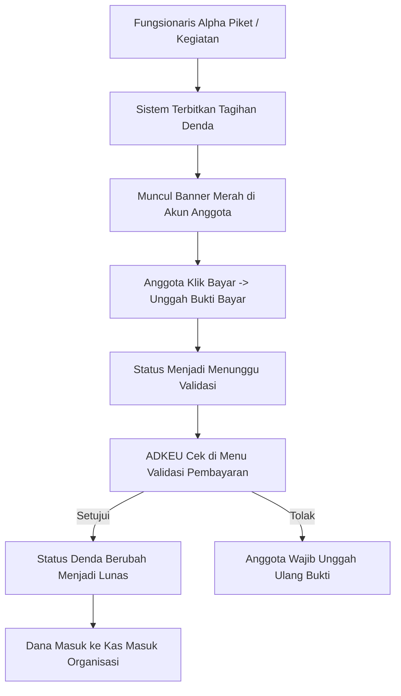

# Modul 04: Manajemen Denda Organisasi

## 1. Deskripsi Fitur
Modul Manajemen Denda berfungsi menegakkan disiplin organisasi fungsionaris BEM FILKOM UB. Sistem secara otomatis maupun manual dapat menerbitkan surat tagihan sanksi finansial (denda) kepada fungsionaris yang melanggar kewajiban kehadiran piket sekretariat atau absensi tanpa keterangan (*alpha*) pada kegiatan wajib organisasi. Fungsionaris dapat meninjau rincian denda dan melakukan pelunasan secara mandiri, sementara bendahara (ADKEU) mengelola penetapan, validasi pembayaran, dan monitoring tunggakan.

---

## 2. Acuan Tangkapan Layar (Screenshots)
- **Halaman Manajemen Denda (ADKEU)**: [`Rekapin-Resource/UI-Bendahara/denda.png`](file:///c:/Users/Archie/Downloads/MPTI-Kelompok1/Rekapin-Resource/UI-Bendahara/denda.png)
- **Halaman Denda Anggota Biasa**: [`Rekapin-Resource/UI-Anggota/denda anggota.png`](file:///c:/Users/Archie/Downloads/MPTI-Kelompok1/Rekapin-Resource/UI-Anggota/denda%20anggota.png)
- **Halaman Denda Pribadi PresBEM**: [`Rekapin-Resource/UI-PresBem/denda pres.png`](file:///c:/Users/Archie/Downloads/MPTI-Kelompok1/Rekapin-Resource/UI-PresBem/denda%20pres.png)

---

## 3. Komponen & Spesifikasi Antarmuka (UI Specification)

### 3.1. Halaman Denda Anggota (*Denda Saya*)
Digunakan oleh fungsionaris (Anggota & PresBEM) untuk memantau sanksi:
1. **Banner Peringatan Denda Aktif (*Red Warning Banner*)**:
   - Berlatar belakang warna merah tebal (`#DC2626` / `#EF4444`) dengan ikon peringatan segitiga.
   - Menampilkan total nominal yang harus dilunasi: e.g. **Rp25.000**.
   - Keterangan status: *"1 denda aktif"*.
2. **Daftar Tagihan & Riwayat Denda**:
   - Kartu denda terbagi atas item yang belum dibayar dan yang sudah selesai:
     - **Item Tagihan Belum Dibayar**:
       - Judul: Jenis sanksi (e.g. *Denda Piket*).
       - Badge Status: `Belum Dibayar` (merah muda).
       - Alasan & Tanggal Kejadian: e.g. *Tidak hadir piket 11/09 (11/09/2025)*.
       - Nominal Denda: Teks merah tebal `Rp25.000`.
       - Tombol Aksi: `[Bayar]` (tombol merah tegas untuk membuka alur unggah bukti transfer).
     - **Item Denda Lunas**:
       - Judul & Alasan: e.g. *Denda Piket · Tidak hadir piket 28/08 (28/08/2025)* atau *Denda Kegiatan · Alpha kegiatan wajib (01/08/2025)*.
       - Badge Status: `Lunas` (hijau muda).
       - Nominal: `Rp25.000` atau `Rp50.000`.

---

### 3.2. Halaman Manajemen Denda (ADKEU)
Digunakan oleh bendahara untuk memantau seluruh denda organisasi:
1. **Kartu Ringkasan Denda**:
   - **Belum Bayar**: `Rp125.000` (4 anggota penunggak).
   - **Sudah Lunas**: `Rp75.000` (2 anggota lunas).
2. **Tombol Aksi**:
   - `[+ Tambah Denda]` di pojok kanan atas untuk menerbitkan sanksi manual.
3. **Filter Status**:
   - Tab tombol: `Semua` | `Belum Bayar` | `Lunas`.
4. **Tabel Data Denda Organisasi**:
   - **ANGGOTA**: Nama fungsionaris dan NIM (e.g. *Ahmad Reza - 215150700111005*).
   - **JENIS**: Kategori pelanggaran (*Denda Piket* atau *Denda Kegiatan*).
   - **ALASAN**: Deskripsi penyebab sanksi (e.g. *Tidak hadir piket 15/09*, *Alpha kegiatan wajib*).
   - **NOMINAL**: Jumlah rupiah yang dikenakan (e.g. `Rp25.000`, `Rp50.000`).
   - **STATUS**: Badge penanda status:
     - `Belum Bayar` (merah muda)
     - `Lunas` (hijau muda)
   - **AKSI**: Tautan `[Detail]` untuk meninjau log perubahan, tanggal pelunasan, dan bukti transfer pembayaran.

---

## 4. Matriks Tarif & Ketentuan Sanksi (Tariff Matrix)

| Kategori Pelanggaran | Nominal Denda | Sumber Pemicu (*Trigger*) | Prosedur Validasi |
| :--- | :---: | :--- | :--- |
| **Denda Piket** | **Rp25.000** | Fungsionaris terdaftar piket tetapi tidak hadir dan tidak mengunggah bukti/izin hingga shift berakhir. | Otomatis dari modul Piket / Manual oleh ADKEU. |
| **Denda Kegiatan Wajib** | **Rp50.000** | Fungsionaris tidak melakukan scan QR presensi kegiatan wajib BEM tanpa surat izin resmi. | Otomatis setelah kegiatan ditutup oleh PSDI. |

---

## 5. Alur Kerja (User Flows)

---

## 6. Aturan Bisnis & Integrasi Keuangan
1. **Otomatisasi Kas Masuk**: Ketika ADKEU memvalidasi pembayaran denda, sistem secara otomatis menambahkan entri baru pada buku besar kas bertipe **Kas Masuk** (seperti tercatat pada pembukuan: *"Denda Piket: 10 denda × Rp25.000 = +Rp250.000"*).
2. **Eskalasi Penunggakan**: Denda yang belum dilunasi lebih dari 30 hari kalender akan otomatis masuk ke dalam sistem **Smart Alert** pada Dashboard Ketua BEM (*"3 anggota denda belum dibayar > 30 hari"*).
3. **Penyelesaian Beban Organisasi**: Fungsionaris tidak dapat memperoleh sertifikat kepengurusan atau surat keterangan aktif fungsionaris BEM bila masih memiliki denda berstatus `Belum Bayar`.
