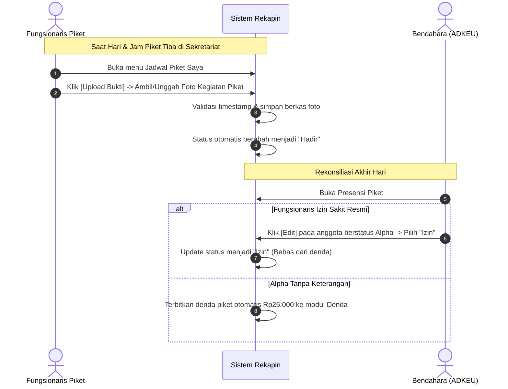

# Modul 05: Penjadwalan & Presensi Piket Sekretariat

## 1. Deskripsi Fitur
Modul Penjadwalan dan Presensi Piket mengatur operasional harian kantor sekretariat BEM FILKOM UB. Modul ini memfasilitasi pembagian jadwal piket kerja fungsionaris secara merata dari hari Senin hingga Jumat, pencatatan presensi mandiri fungsionaris dengan bukti foto (*photo timestamp verification*), verifikasi dan koreksi status kehadiran oleh ADKEU, serta perhitungan rasio kedisiplinan fungsionaris.

---

## 2. Acuan Tangkapan Layar (Screenshots)
- **Kelola Jadwal Piket Mingguan (ADKEU)**: [`Rekapin-Resource/UI-Bendahara/jadwal piket.png`](file:///c:/Users/Archie/Downloads/MPTI-Kelompok1/Rekapin-Resource/UI-Bendahara/jadwal%20piket.png)
- **Presensi Piket Harian & Edit Status (ADKEU)**: [`Rekapin-Resource/UI-Bendahara/presensi piket.png`](file:///c:/Users/Archie/Downloads/MPTI-Kelompok1/Rekapin-Resource/UI-Bendahara/presensi%20piket.png)
- **Jadwal Piket Saya & Unggah Bukti (Anggota)**: [`Rekapin-Resource/UI-Anggota/jadwal piket anggota.png`](file:///c:/Users/Archie/Downloads/MPTI-Kelompok1/Rekapin-Resource/UI-Anggota/jadwal%20piket%20anggota.png)
- **Jadwal Piket Saya & Unggah Bukti (PresBEM)**: [`Rekapin-Resource/UI-PresBem/jadwal piket pres.png`](file:///c:/Users/Archie/Downloads/MPTI-Kelompok1/Rekapin-Resource/UI-PresBem/jadwal%20piket%20pres.png)
- **Riwayat Presensi Piket (Anggota & PresBEM)**:
  - [`Rekapin-Resource/UI-Anggota/riwayat presensi anggota.png`](file:///c:/Users/Archie/Downloads/MPTI-Kelompok1/Rekapin-Resource/UI-Anggota/riwayat%20presensi%20anggota.png)
  - [`Rekapin-Resource/UI-PresBem/riwayat presensi pres.png`](file:///c:/Users/Archie/Downloads/MPTI-Kelompok1/Rekapin-Resource/UI-PresBem/riwayat%20presensi%20pres.png)

---

## 3. Komponen & Spesifikasi Antarmuka (UI Specification)

### 3.1. Halaman Plotting Jadwal Piket (ADKEU)
Digunakan oleh bendahara untuk mengatur giliran jaga sekretariat:
1. **Header & Tombol Tambah**:
   - Judul: *"Jadwal Piket - Atur dan kelola jadwal piket anggota"*.
   - Tombol Aksi: `[+ Tambah Jadwal]` (membuka modal penugasan anggota ke shift tertentu).
2. **Filter Hari**:
   - Tab tombol: `Semua` | `Senin` | `Selasa` | `Rabu` | `Kamis` | `Jumat`.
3. **Kartu Hari & Shift Piket**:
   - Setiap hari memiliki kartu tersendiri yang menampilkan total petugas:
     - **Senin (5 anggota)**:
       - Shift Pagi: `08:00 – 10:00` · Sekretariat -> Badge: *Budi*, *Dewi*, *Rizky*.
       - Shift Siang: `13:00 – 15:00` · Sekretariat -> Badge: *Ahmad*, *Siti*.
     - **Selasa (5 anggota)**:
       - Shift Pagi: `08:00 – 10:00` -> Badge: *Maya*, *Cici*, *Dedy*.
       - Shift Siang: `13:00 – 15:00` -> Badge: *Eka*, *Fauzan*.
     - **Rabu (2 anggota)**:
       - Shift Pagi: `08:00 – 10:00` -> Badge: *Gita*, *Hendra*.
     - **Kamis (3 anggota)**:
       - Shift Pagi: `08:00 – 10:00` -> Badge: *Budi*, *Maya*, *Rizky*.
     - **Jumat (2 anggota)**:
       - Shift Pagi: `08:00 – 10:00` -> Badge: *Ahmad*, *Cici*.

---

### 3.2. Halaman Jadwal Piket Saya & Unggah Bukti (Anggota & PresBEM)
Digunakan fungsionaris untuk meninjau jadwal pribadi dan melakukan presensi:
1. **Kartu Ringkasan Kehadiran Piket Mandiri**:
   - **Hadir**: `6` (angka hijau tebal).
   - **Alpha**: `1` (angka merah tebal).
   - **Kehadiran**: `86%` (persentase kepatuhan hijau).
2. **Daftar Kartu Jadwal Piket**:
   - Setiap item jadwal memiliki:
     - **Blok Tanggal**: Hari, tanggal, bulan/tahun (e.g. `Sen 01 09/2025`, `Kam 11 09/2025`).
     - **Jam & Lokasi**: `08:00 – 10:00 · Sekretariat`.
     - **Tautan Berkas Bukti**: Tautan file bukti foto yang telah diunggah (e.g. `📎 foto_piket_1.jpg`).
     - **Status & Tombol Aksi**:
       - Status `Hadir`: Badge hijau muda tanpa tombol aksi tambahan.
       - Status `Alpha`: Badge merah muda + Tombol merah `[Upload Bukti]` (untuk susulan/klarifikasi).
       - Status `Akan Datang`: Badge biru muda + Tombol toska `[Upload Bukti]` (untuk presensi saat jadwal aktif).

---

### 3.3. Halaman Presensi Piket & Rekonsiliasi (ADKEU)
Digunakan oleh ADKEU untuk memvalidasi log piket harian:
1. **Kartu Ringkasan Presensi**:
   - **Hadir**: `5` (hijau).
   - **Alpha**: `2` (merah).
   - **Izin**: `1` (kuning).
2. **Filter Status**:
   - Tab tombol: `Semua` | `Hadir` | `Alpha` | `Izin`.
3. **Tabel Log Presensi Piket**:
   - **ANGGOTA**: Nama fungsionaris & NIM (e.g. *Budi Santoso - 215150700111001*).
   - **HARI / SHIFT**: Hari dan jam tugas (e.g. *Senin 08:00 – 10:00*).
   - **TANGGAL**: Tanggal tugas (e.g. `22/09/2025`).
   - **KETERANGAN**: Catatan fungsionaris (e.g. `—`, `Tidak ada pemberitahuan`, `Sakit (ada surat)`).
   - **STATUS**: Badge `Hadir` (hijau), `Alpha` (merah), `Izin` (kuning).
   - **AKSI**: Tautan `[Edit]` untuk mengubah status presensi dan menambahkan catatan dispensasi.

---

### 3.4. Tab Riwayat Presensi Piket
Menampilkan tabel riwayat individual fungsionaris:
- Tabs: `Piket` | `Kegiatan`.
- Kolom Tabel: `Tanggal`, `Shift`, `Lokasi`, dan `Status`.

---

## 4. Alur Kerja Presensi Piket (Workflow)

---

## 5. Aturan Bisnis & Validasi (Business Rules)
1. **Waktu Shift Standar**:
   - Shift Pagi: `08:00 – 10:00 WIB`.
   - Shift Siang: `13:00 – 15:00 WIB`.
2. **Tenggat Unggah Bukti**: Bukti foto piket wajib diunggah paling lambat 15 menit setelah shift berakhir. Melebihi batas waktu tersebut, sistem secara otomatis menandai status sebagai `Alpha`.
3. **Ketentuan Denda Alpha Piket**: Status `Alpha` yang tidak diubah menjadi `Izin` oleh ADKEU dalam waktu 1x24 jam akan langsung mengenerate tagihan denda sebesar **Rp25.000**.
4. **Validasi Berkas**: Format file bukti piket berupa `JPG`, `PNG` dengan ukuran berkas maksimal 3 MB.
