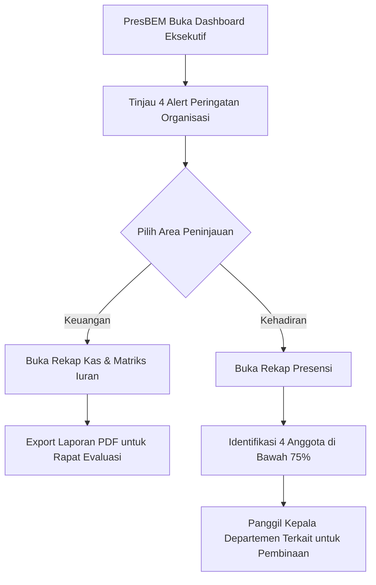

# Modul 07: Rekapitulasi, Pelaporan & Pengawasan Eksekutif

## 1. Deskripsi Fitur
Modul Rekapitulasi dan Laporan menyediakan ringkasan transaksi kas dan kedisiplinan presensi kegiatan bagi pimpinan organisasi (**PresBEM / Ketua BEM**) dan pengurus harian (**ADKEU & PSDI**). Laporan membaca transaksi kas, status pembayaran yang disetujui, agenda kegiatan, dan presensi fungsionaris yang tersimpan di sistem. Laporan kas dan presensi dapat diunduh sebagai CSV atau dicetak/disimpan sebagai PDF melalui dialog cetak browser.

---

## 2. Acuan Tangkapan Layar (Screenshots)
- **Halaman Rekap Presensi (ADKEU, PSDI & PresBEM)**:
  - [`Rekapin-Resource/UI-Bendahara/rekap presensi.png`](file:///c:/Users/Archie/Downloads/MPTI-Kelompok1/Rekapin-Resource/UI-Bendahara/rekap%20presensi.png)
  - [`Rekapin-Resource/UI-PSDI/rekap piket.png`](file:///c:/Users/Archie/Downloads/MPTI-Kelompok1/Rekapin-Resource/UI-PSDI/rekap%20piket.png)
  - [`Rekapin-Resource/UI-PSDI/rerkap kegiatan.png`](file:///c:/Users/Archie/Downloads/MPTI-Kelompok1/Rekapin-Resource/UI-PSDI/rerkap%20kegiatan.png)
  - [`Rekapin-Resource/UI-PresBem/rekap presensi.png`](file:///c:/Users/Archie/Downloads/MPTI-Kelompok1/Rekapin-Resource/UI-PresBem/rekap%20presensi.png)
- **Halaman Rekap Kas & Matriks Iuran (ADKEU & PresBEM)**:
  - [`Rekapin-Resource/UI-Bendahara/rekap kas.png`](file:///c:/Users/Archie/Downloads/MPTI-Kelompok1/Rekapin-Resource/UI-Bendahara/rekap%20kas.png)
  - [`Rekapin-Resource/UI-PresBem/rekap kas.png`](file:///c:/Users/Archie/Downloads/MPTI-Kelompok1/Rekapin-Resource/UI-PresBem/rekap%20kas.png)
- **Dashboard Pengawasan Eksekutif (PresBEM)**:
  - [`Rekapin-Resource/UI-PresBem/dashboard pres.png`](file:///c:/Users/Archie/Downloads/MPTI-Kelompok1/Rekapin-Resource/UI-PresBem/dashboard%20pres.png)

---

## 3. Komponen & Spesifikasi Antarmuka (UI Specification)

### 3.1. Halaman Rekap Presensi Organisasi
Dapat diakses oleh **ADKEU**, **PSDI**, dan **PresBEM**:
1. **Kartu Ringkasan Metrik**:
   - Rata-rata kehadiran, total Alpha, total izin, dan jumlah fungsionaris di bawah 75%.
2. **Grafik Presensi Kegiatan**:
   - Membandingkan jumlah hadir, izin, dan Alpha dari maksimal 12 kegiatan selesai terbaru.
   - Kegiatan aktif dan mendatang tidak masuk statistik kedisiplinan.
4. **Tabel Evaluasi Kehadiran per Anggota**:
   - Kolom:
     - `ANGGOTA`: Nama fungsionaris dan NIM.
     - `Hadir`: Jumlah sesi hadir (e.g. `18`, `16`, `14`, `12`, `17`, `15`, `10`).
     - `Alpha`: Jumlah sesi alpha tanpa izin (e.g. `0`, `1`, `3`, `5`, `0`, `2`, `7`).
     - `Izin`: Jumlah sesi izin resmi (e.g. `0`, `1`).
     - `%`: Progress bar indikator dan nilai persentase:
       - Hijau Toska: `>= 80%` (e.g. *Budi Santoso 100%*, *Siti Rahayu 94%*, *Dewi Lestari 89%*, *Maya Putri 83%*).
       - Kuning Emas: `70% - 79%` (e.g. *Rizky Aditya 78%*).
       - Merah Peringatan: `< 70%` (e.g. *Ahmad Reza 67%*, *Cici Amelia 56%*).

---

### 3.2. Halaman Rekap Kas Organisasi
Dapat diakses oleh **ADKEU/Bendahara** dan **PresBEM**:
1. **Kartu Agregasi Keuangan**:
   - Total pemasukan dan pengeluaran berdasarkan seluruh transaksi yang tercatat; saldo adalah selisih keduanya.
2. **Ekspor dan Cetak**:
   - CSV memuat ringkasan, arus kas bulanan, rincian transaksi/saldo berjalan, dan matriks pembayaran; tombol cetak browser dapat digunakan untuk menyimpan tampilan laporan sebagai PDF.
3. **Grafik Arus Kas**:
   - Membandingkan pemasukan dan pengeluaran per bulan selama tujuh bulan terakhir.
4. **Matriks Pembayaran Kas**:
   - Menampilkan pembayaran berstatus disetujui per anggota selama tujuh bulan terakhir.

Rekap presensi dapat diakses oleh **ADKEU/Bendahara, PSDI, dan PresBEM**. Jadwal piket dikelola Bendahara/ADKEU, anggota melakukan presensi dengan foto selama jam shift, dan halaman Presensi Piket menampilkan status serta bukti dari catatan yang tersimpan.

---

### 3.3. Panel Pengawasan Eksekutif (Dashboard PresBEM)
Menyajikan 2 instrumen pengawasan kunci Ketua BEM:
1. **Pusat Peringatan Kedisiplinan (*Notifikasi & Perhatian*)**:
   - 🟡 *7 anggota belum bayar kas September (Hari ini)*.
   - 🔴 *4 anggota di bawah 75% kehadiran piket (Kemarin)*.
   - 🟢 *Kegiatan Seminar berhasil dilaksanakan, 28/30 hadir (21/09/2025)*.
   - 🟡 *3 anggota denda belum dibayar > 30 hari (20/09/2025)*.
2. **Tabel Kinerja Per Departemen (*Departmental KPI Overview*)**:

| Departemen BEM | Fungsionaris Aktif | Rasio Lunas Kas | Rata-rata Kehadiran | Tingkat Kepatuhan |
| :--- | :---: | :---: | :---: | :--- |
| **ADKEU** | 5 Orang | 5/5 (100%) | 94% | 🟢 Sangat Baik |
| **PSDI** | 6 Orang | 4/6 (66.7%) | 88% | 🟢 Baik |
| **Kementerian A** | 7 Orang | 5/7 (71.4%) | 82% | 🟡 Cukup |
| **Kementerian B** | 8 Orang | 6/8 (75.0%) | 91% | 🟢 Sangat Baik |
| **Anggota Umum** | 6 Orang | 4/6 (66.7%) | 75% | 🔴 Perhatian Khusus |

---

## 4. Alur Kerja Pengawasan & Evaluasi (Workflow)

---

## 5. Aturan Bisnis & Ambang Batas (Thresholds)
1. **Standar Kehadiran Minimum**: Ambang batas kelulusan keaktifan organisasi ditetapkan sebesar **75%**. Anggota dengan persentase di bawah ambang batas ini secara otomatis ditandai merah (*flagged*) untuk evaluasi kepengurusan.
2. **Kesesuaian Data Kas**: Saldo kas yang ditampilkan pada Rekap Kas wajib sinkron 100% dengan total mutasi kas masuk dan kas keluar pada modul ADKEU.
3. **Format Dokumen Ekspor**: Dokumen PDF hasil ekspor menyertakan nomor dokumen, stempel digital organisasi, dan nama penanggung jawab (Bendahara Umum & Ketua BEM).
